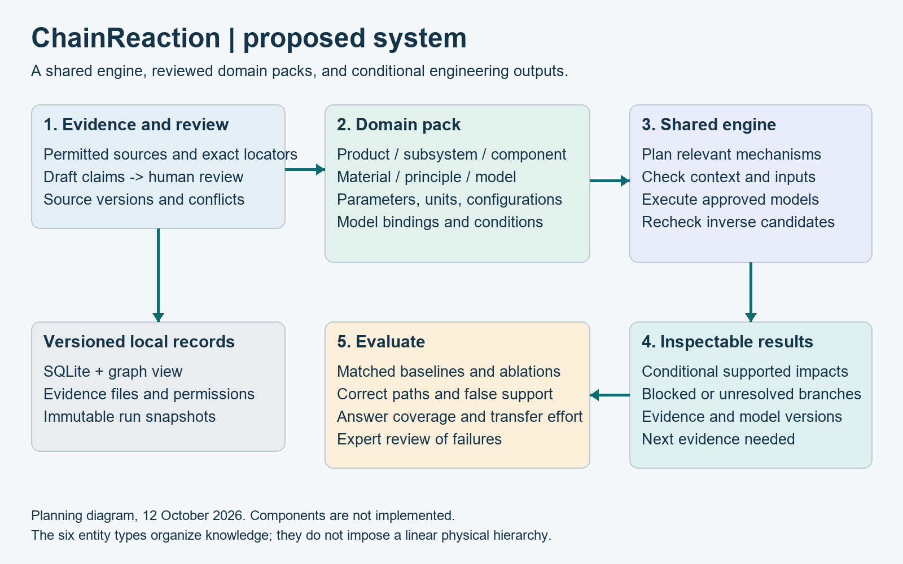

# Proposed architecture

Date: 12 October 2026. All components below are planned.

## Component responsibilities

| Component | Owns | Must not do |
|---|---|---|
| Evidence importer | Source versions, permissions, text spans, figures, locators | Execute document instructions or approve scientific claims |
| Curation service | Entity matching, relationship drafts, human reviews, conflict records | Overwrite disagreeing evidence to simplify the graph |
| Domain registry | Pack version, terminology, allowed model bindings, units, tests | Place industry-specific rules in the shared engine |
| Graph planner | Candidate impact paths and reverse relevance paths | Treat structural adjacency as an executable dependency |
| Applicability checker | Scenario context, assumptions, units, validity bounds | Fill unknown conditions with convenient defaults |
| Model executor | Allowlisted numerical functions, constraint checks, solver results | Run source-supplied code or arbitrary `eval` |
| Result builder | Supported and unresolved branches, provenance, limitations | Convert refusal into a fabricated summary answer |
| Review interface | Input forms, path drilldown, source inspection, export | Hide rejected options or context mismatches |
| Evaluation runner | Frozen scenarios, baselines, metrics, reproducible outputs | Tune against held-out reference answers |

## Recommended initial stack

Use Python for the shared engine. Store normalized records in SQLite, with explicit foreign keys and migration files. Build the graph view using NetworkX. Use Pydantic or an equivalent validator for API contracts, Pint for unit handling, and allowlisted Python functions for initial models. SymPy may assist reviewed symbolic work; it must not accept arbitrary document expressions for execution. Select package versions after checking official documentation when implementation begins.

A Streamlit interface is a pragmatic first demonstration. Add FastAPI and a separate frontend only if team needs justify the extra work. These are architectural recommendations; no framework installation or server is required by this planning task.

The proposed graph, units, local-storage, and symbolic-math roles were checked against their official documentation: [NetworkX](https://networkx.org/documentation/stable/), [Pint](https://pint.readthedocs.io/en/stable/), [SQLite](https://www.sqlite.org/about.html), and [SymPy](https://docs.sympy.org/latest/index.html). This verifies their intended roles, not compatibility of an unbuilt application stack. Pin and test the application environment when implementation starts.

Use local files for permitted evidence and hash/version records in SQLite. Migrate to a graph database only after profiling demonstrates a real traversal or concurrency need. The evidence, logical graph, and run store are distinct responsibilities even when one database serves them.

## Record flow

1. Import a source and record access/reuse conditions and content fingerprint.
2. Create candidate entities, parameter claims, relationships, and model records with exact locations.
3. Review and publish a domain-pack revision. Maintain an immutable revision history.
4. Validate a scenario against the chosen pack and configured product.
5. Plan candidate paths using allowed relation categories.
6. Check model applications and calculate only eligible branches.
7. Collect supported, blocked, conflicting, and unresolved results without inventing missing links.
8. Persist the run and export its reasoning certificate.

## Proposed reasoning certificate

The certificate is a structured run record, not a formal proof or a patent novelty claim. It records each mechanism step, input source or user origin, unit conversion, condition check, approved model version, result, and blocker. It enables a reviewer to reproduce the calculation and identify why a conclusion stopped.

## API outline

| Endpoint | Input | Output |
|---|---|---|
| `POST /packs/validate` | Domain-pack JSON | Structural and semantic violations |
| `POST /scenarios/forward` | Pack version, configuration, changes, context | Analysis run ID and result states |
| `POST /scenarios/backward` | Target, controllable variables, constraints, search limits | Candidate interventions and forward-check records |
| `GET /runs/{id}` | Authorized run ID | Reproducible certificate and impacts |
| `GET /evidence/{id}` | Authorized evidence ID | Locator and permitted excerpt |
| `POST /reviews` | Claim ID, decision, reviewer, justification | New immutable review record |

These endpoints are design contracts, not working services. Validate requests, use explicit enums, and reject unknown pack versions. Analysis failures should return a structured reason rather than an unqualified generated answer.

## Cycles and coupled models

The first executable pack should use acyclic model applications. Structural cycles may exist and must not break graph browsing. Numerical cycles are `unresolved` unless the pack registers an approved coupled solver with convergence criteria, initial conditions, limits, and failure behavior. A traversal visited set alone is not a solution to a physical feedback loop.

## Security and privacy

Treat imported text as untrusted evidence. LLM extraction, if added, uses structured outputs with no authority to call tools from source text. Strip active content, limit files and resources, and keep an allowlisted model registry. Store credentials outside Git. An external-model request needs an authorized data source and service configuration, and must avoid personal contact records.

## Transfer boundary

Domain packs can define specialized context and constraints while the engine uses generic IDs, typed quantities, condition predicates, model signatures, and search budgets. If every new domain demands core exceptions, revise the abstraction and report the transfer cost rather than calling it universal.
