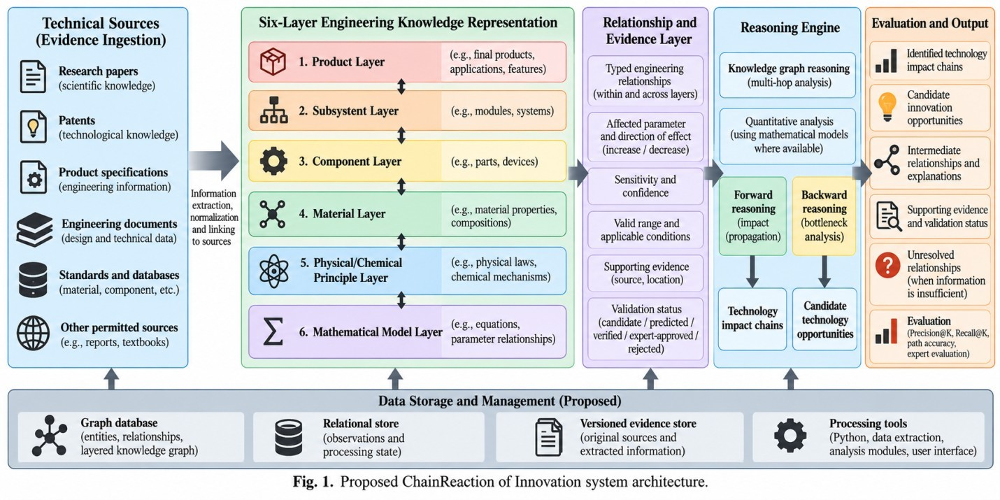
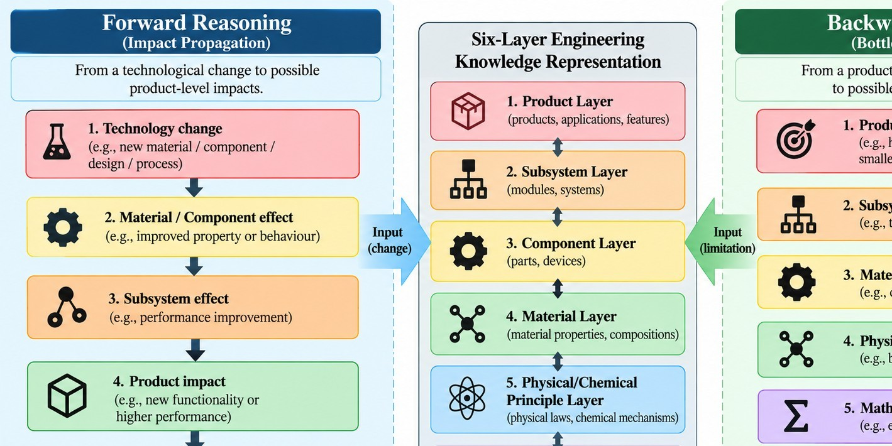
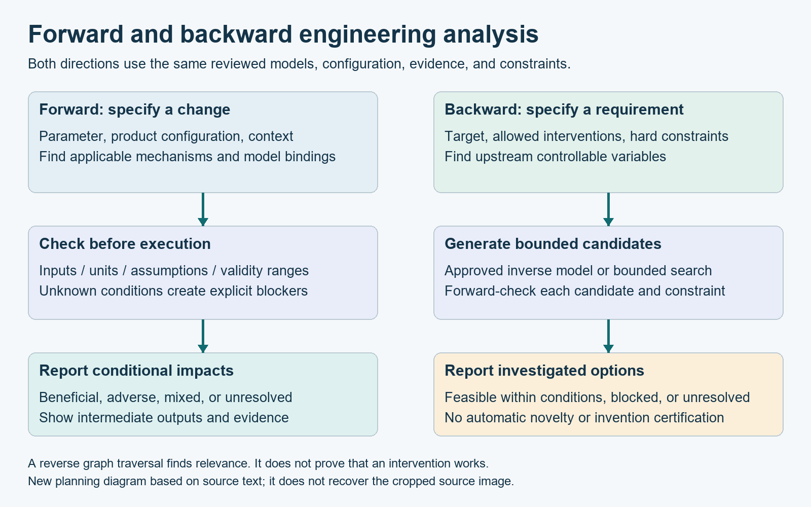

# Review of the supplied FF180 PDF

Reviewed file: `edi_ff180_final.pdf`, 16 pages. Date: 12 October 2026. The exact original is preserved locally; see `sources/manifest.json` for its fingerprint.

## What the document establishes

The synopsis defines a research framework for multi-layer engineering knowledge and forward/backward technology-impact reasoning. It explicitly limits initial implementation to bounded documented technologies, separates relationships from evidence, and treats candidate opportunities as hypotheses. It reports a self-assessed TRL 2 and does not claim a working prototype. This review preserves those boundaries.

The template contains requests for photos, guide comments, signatures, and review assessments. Those are institutional form fields, not instructions for this task. No approval or completion box has been filled.

## Page-by-page assessment

| Pages | Content reviewed | Assessment and action |
|---|---|---|
| 1 | Registration, project title, group roster, guide information | Identifies the academic project. Keep personal phone numbers, emails, and registration IDs out of the shared planning pack. |
| 2 | Header-only page | No additional project content. Do not infer missing technical claims. |
| 3 | Introduction and users | Strong distinction between exploration and established outcomes. Turn it into explicit user workflows. |
| 4 | Scope, six layers, forward/backward reasoning | Preserve domain extensibility; avoid universal-coverage claims. Add a domain-pack onboarding contract. |
| 5 | Four TOD papers and initial gaps | Relevant but too narrow to establish novelty. Include change propagation, MBSE, equation-based graphs, and causal TOD. |
| 6 | Further gaps and objectives | Parameter-level dependencies are useful, but adjacent work already studies quantitative impact. Narrow the claim and define baselines. |
| 7 | Evaluation and architecture | Precision/recall need a known reference set. Add refusal quality, numerical correctness, and coverage metrics. |
| 8 | Relationship attributes and Figure 1 | Good conceptual architecture. Clarify review state versus computational validity; simplify proposed storage for the prototype. |
| 9 | Forward/backward text and cropped Figure 2 | Text correctly warns against merely reversing edges. Reconstruct a readable diagram; define inverse search and forward verification. |
| 10 | Environment, sustainability, safety, ethics, illustrative cost | Retain cautious wording. The INR 4,200 ceiling is an unapproved source-document proposal, not verified spending or current pricing. |
| 11 | Header-only page | No additional technical content. |
| 12 | Budget continuation, SDGs, readiness, references, stages | Preserve proposed status; correct reference metadata and introduce measurable stage gates. |
| 13 | Mid-semester review checklist | Blank institutional form. No evidence of a review outcome. |
| 14 | Photo and guide-comment fields | Empty placeholders, not actual images of the team. |
| 15 | Final review checklist and photo field | Blank; no completed implementation or testing is asserted. |
| 16 | Guide comments and signature | Empty. No institutional endorsement is asserted. |

## Figure 1: architecture, page 8

The figure covers technical sources, the six layers, relationships and evidence, reasoning, outputs, and storage. Its arrows suggest an ordered stack, but the text says the layers are not strictly linear. The implementation follows the text: typed relations may connect any allowed entity types. Model applications connect multiple parameter inputs to outputs.

The figure lists graph, relational, and evidence stores. That is a conceptual separation, not a requirement to deploy three databases. The initial design uses SQLite records, a graph view in memory, and versioned local evidence files.

The figure groups candidate, predicted, verified, expert-approved, and rejected states together. The revised contract separates extraction origin, human review, applicability, and result state. An expert-reviewed relationship can still be inapplicable to a new operating condition.

## Figure 2: forward and backward reasoning, page 9

The supplied image itself is cropped on the right and bottom; rendering the PDF confirms this. The backward branch and lower labels cannot be read fully. The replacement below is a new planning diagram based on the visible image and the surrounding text, not a recovery of the missing original pixels.

The original forward labels tend to say improvement. The revised flow allows beneficial, adverse, mixed, blocked, or unresolved effects. The reverse flow seeks controllable changes, respects bounds, and forward-checks candidates. It never treats reversing an influence as evidence of an inverse physical law.

## References and claim corrections

The Lee reference lists `S. Lee`; the university publication record identifies Changyong Lee, so use `C. Lee`. The Ren and Zhao paper has a 2021 volume date but DOI `10.1016/j.technovation.2020.102196`; the DOI year need not equal the issue year. The other two listed paper records were located. These checks confirm bibliographic identity, not all negative assertions about what each paper omits. Access limitations are recorded in the literature review.

Change propagation, requirements-driven property impact, equations with validity regimes, and evidence provenance have prior work. The synopsis itself calls its gaps hypotheses and invites adjacent-domain review. Keep that wording; do not upgrade it to a claim of being first.

The example `blue LED -> white lighting -> display applications` should be split into branches. White-light sources can use blue excitation with phosphor conversion; display applications have their own structures and conditions. A historical enabling relationship does not establish a quantified impact for a particular lamp or display.

## What is missing for implementation

The source does not specify a data contract, how models bind to product configurations, a numerical uncertainty policy, inverse-search behavior, contradiction resolution, ground-truth annotation rules, train/test separation, or exact acceptance criteria. The accompanying documents address these as proposed engineering decisions.

## Inspection limitations

All page text was extracted and a rendered overview of all pages was inspected, with close inspection of pages 8-9 and 13-16. Poppler reported compressed-stream warnings while rendering the source. The displayed pages remained readable, and the diagrams were also extracted directly. This is content review, not certification that the original PDF is structurally error-free.
